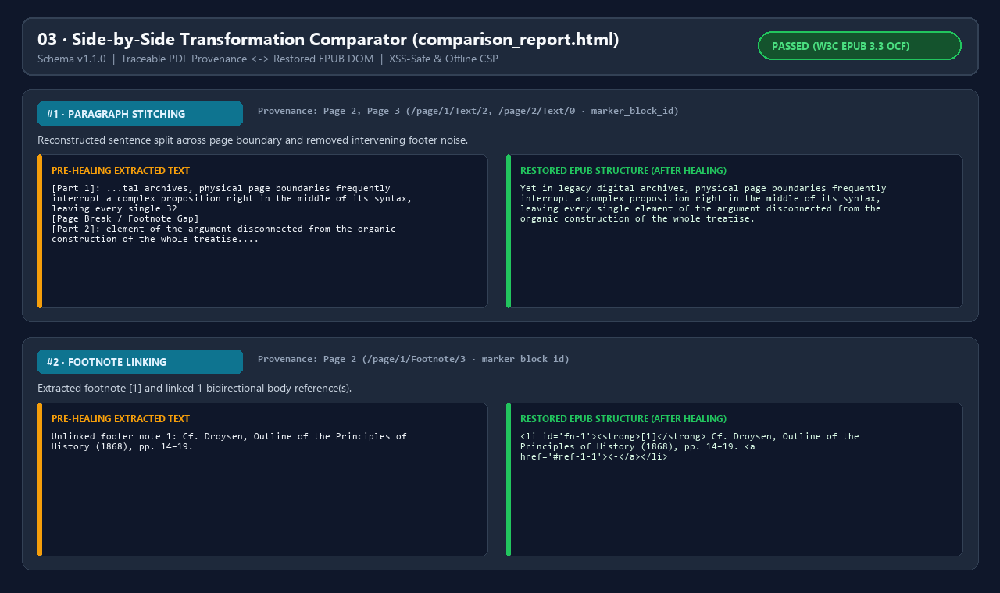
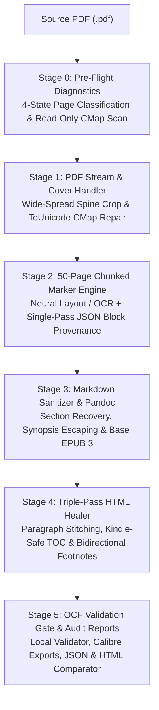
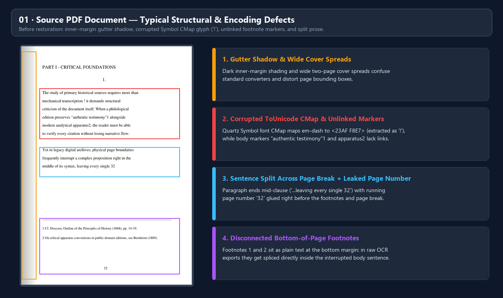
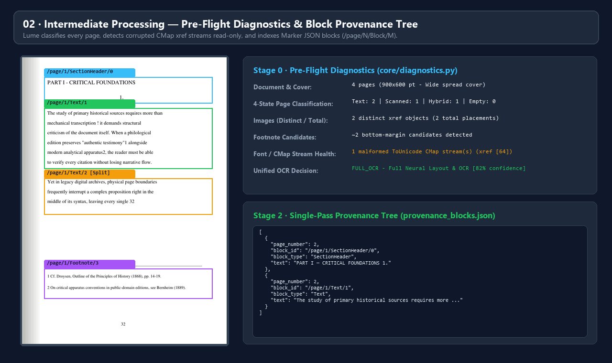
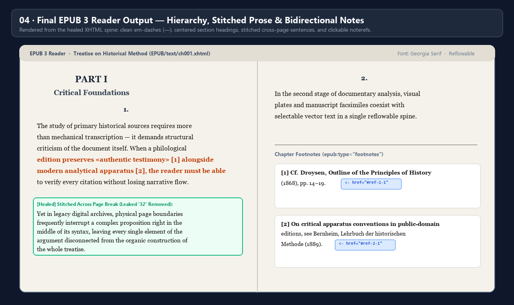
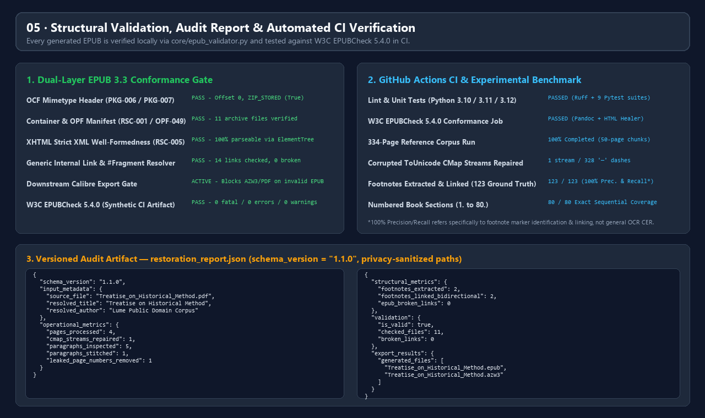

# Lume

[](https://github.com/ledrodh/Lume/actions/workflows/ci.yml)


**Lume** is a document restoration, provenance auditing, and e-book validation platform that transforms complex academic PDFs, philosophical treatises, and historical scans into structured, navigable e-books (**EPUB 3**, **Kindle AZW3**, and **reflowable PDF**).



---

## 🎯 Overview: What Problem Does Lume Solve?

Standard PDF-to-EPUB converters treat academic and historical books as flat text streams. When applied to scanned editions or complex scholarly layouts, they routinely produce broken e-books:

- **Interrupted Prose**: Sentences split across physical page boundaries remain fragmented, often with running headers, page numbers (`32`), or bottom-of-page footnotes spliced directly into the middle of a paragraph.
- **Disconnected Apparatus**: Footnote markers in the body text lose their connection to the notes at the bottom of the page, or ordinary numbers (years, quantities, section headers) are falsely converted into broken links.
- **Corrupted Font Encodings**: Legacy `ToUnicode` CMap streams (such as macOS Quartz `Symbol` fonts mapping em-dashes `—` to `<23AF F8E7>`) extract as `!` or Private Use Area boxes.
- **Memory Exhaustion & Unverified Output**: Running neural OCR on 300+ page books in a single pass can exhaust RAM/VRAM (`_ArrayMemoryError`), and repackaged archives frequently violate W3C EPUB 3.3 OCF rules.

Lume addresses these problems as an observable software engineering pipeline: inspecting the document before conversion, executing layout/OCR in memory-safe 50-page chunks, healing the HTML DOM in three passes, mapping transformations back to their source PDF pages, and validating the final archive before export.

---

## ✨ Core Capabilities

1. **🔍 Two-Stage Pre-Flight Diagnostics (`core/diagnostics.py`)**: Performs a fast `< 100ms` preview followed by a full read-only background scan that classifies every page into `extractable_text`, `image_only`, `mixed` (hybrid/OCR-overlay), or `empty_or_unknown`, counts distinct image `xref` objects vs. total placements, detects malformed `ToUnicode` CMap streams, and selects a unified OCR strategy (`disable_ocr` vs. `full_ocr`).
2. **🔧 Stream Sanitization & Triple-Pass HTML Healing (`core/pdf_handler.py`, `core/html_healer.py`)**: Crops wide two-page cover spreads in visual coordinates (safe on rotated pages), repairs corrupted CMap streams, unwraps false `<sup>` tags, stitches paragraphs split across page breaks, rebuilds Kindle-safe Tables of Contents, and links footnotes bidirectionally (`noteref` ↔ `↩`).
3. **📊 Progressive Provenance & Visual Comparator (`core/reporting.py`)**: Extracts Marker's JSON block tree (`/page/N/BlockType/M`) during conversion with a PyMuPDF page-text fallback (`marker_block_id` → `page_text_match` → `unresolved`, including multi-page ambiguity detection). Emits a privacy-sanitized, versioned `restoration_report.json` (`v1.1.0`) and an offline, XSS-safe `comparison_report.html`.
4. **🛡️ Dual-Layer EPUB 3.3 Validation (`core/epub_validator.py`)**: Verifies every generated archive locally (`ZIP_STORED` `mimetype` at offset 0, `META-INF/container.xml`, OPF manifest/spine consistency, XML well-formedness, and generic resolution of all internal `href`/`src` targets and `#fragment` anchors). Blocks downstream Calibre exports (`AZW3`/`PDF`) if critical structural errors are present, and verifies synthetic healed EPUBs against **W3C EPUBCheck 5.4.0** in CI.

---

## 🔄 How It Works



> 📄 See [`docs/pipeline.md`](docs/pipeline.md) for the stage-by-stage specification of inputs, transformations, and outputs.

---

## 🖼️ Engineering Showcase

All five visual artifacts below were generated from a single public-domain demonstration document (*Treatise on Historical Method*) processed through Lume's pipeline.

### 01. Source Document — Structural & Encoding Defects

*The input PDF page exhibits four common obstacles: inner-margin gutter shading, a corrupted Quartz `Symbol` font CMap stream that extracts em-dashes as `!`, unlinked body footnote markers, and a sentence interrupted mid-clause at the page boundary with a leaked footer number (`32`).*

### 02. Intermediate Processing — Pre-Flight Diagnostics & Provenance Tree

*Before conversion begins, `core/diagnostics.py` classifies all pages (`Text`, `Scanned`, `Hybrid`, `Empty`), flags malformed `ToUnicode` CMap `xref` streams read-only, and selects `full_ocr`. During extraction, Marker's `JSONRenderer` indexes structural blocks (`/page/1/Text/2`, `/page/1/Footnote/3`) into `provenance_blocks.json`.*

### 03. Before / After Transformation — Visual Provenance Comparator

*`core/reporting.py` generates an offline, CSP-protected `comparison_report.html` pairing pre-healing extracted text and source page provenance (`Page 2, Page 3 · /page/1/Text/2, /page/2/Text/0 · marker_block_id`) against the restored EPUB DOM.*

### 04. Final EPUB 3 Output — Structured E-Book & Bidirectional Notes

*In the resulting EPUB 3 spine (`EPUB/text/ch001.xhtml`), standalone numbers become centered `<h3>` headings, the cross-page sentence is stitched seamlessly without the leaked `32`, em-dashes (`—`) are restored, and footnote markers link bidirectionally to `<section epub:type="footnotes">`.*

### 05. Structural Validation & Automated CI Verification

*Every run produces a privacy-sanitized `restoration_report.json` (`v1.1.0`) recording operational counters, structural metrics, and `core/epub_validator.py` results, backed by automated GitHub Actions testing across Python 3.10–3.12 and **W3C EPUBCheck 5.4.0**.*

---

## 📊 Experimental Benchmark (334-Page Reference Treatise)

Evaluated on a 334-page academic philosophical treatise (*O Trabalhador — Domínio e Figura*, Portuguese edition of Ernst Jünger's *Der Arbeiter*, containing 123 scholarly footnotes, 80 numbered sections, and a corrupted Quartz `Symbol` font CMap):

| Metric | Evaluation Type | Baseline (Raw Marker + Pandoc) | Lume Restored Output |
| --- | --- | --- | --- |
| **334-Page Full Run Completion** | Operational | Crashed (`_ArrayMemoryError` in RAM) | **100% Completed** (50-page chunks) |
| **Corrupted `ToUnicode` CMap Streams Repaired** | Operational | 0 (97 em-dashes extracted as `!`) | **1 stream repaired / 328 clean `—` dashes** |
| **Leaked Page Numbers & False `<sup>` Removed** | Operational | 300+ artifacts left in body text | **0 remaining in body prose** |
| **Footnotes Extracted (`123` Ground Truth)** | Structural | 0 / 123 | **123 / 123** |
| **Bidirectional Footnote Links (`noteref` ↔ `↩`)** | Structural | 0 / 123 | **123 / 123** |
| **Footnote Marker Identification Precision / Recall\*** | Ground-Truth Quality | 0.0% / 0.0% | **100.0% Precision / 100.0% Recall** |
| **Numbered Book Sections (`1.` to `80.`)** | Sequential Coverage | Broken into empty `<ol>` lists | **80 / 80 Exact Sequential Coverage** |
| **W3C EPUB 3.3 OCF & Internal Link Integrity** | Validation | Invalid (`mimetype` deflated) | **0 errors, 0 broken links** |

> **\*Scope Note on Benchmark Metrics & CI:**
> - **100.0% Precision / 100.0% Recall** measures **footnote marker identification and bidirectional linking** against the 123 manually verified footnotes in the reference corpus (0 false-positive body numbers linked, 0 missed footnote markers). It does **not** represent general character-level OCR accuracy (CER/WER).
> - The **80 numbered sections** (`1.`–`80.`) were verified separately for **exact sequential coverage (`80 / 80`)**, including sections printed without periods (`53`) or at bottom page margins (`67.`).
> - In GitHub Actions CI, the **W3C EPUBCheck 5.4.0** job validates a synthetic healed EPUB generated by Pandoc + `process_epub_html` to verify OCF/XHTML conformance without downloading multi-gigabyte OCR weights on CI runners.
> - Full methodology, formulas, and provenance tiers are documented in [`docs/benchmark.md`](docs/benchmark.md).

---

## ⚙️ Installation

### Prerequisites
- **Python 3.10, 3.11, or 3.12**
- **[Pandoc](https://pandoc.org/installing.html)** (required for base EPUB 3 compilation)
- **[Calibre](https://calibre-ebook.com/download)** *(optional, required only for `AZW3` and reflowable `PDF` exports)*

### Setup

1. **Clone the repository and create a virtual environment:**
   ```bash
   git clone https://github.com/ledrodh/Lume.git
   cd Lume
   python -m venv venv
   ```
   Activate on Windows (`.\venv\Scripts\activate`) or Linux/macOS (`source venv/bin/activate`).

2. **Install PyTorch for your hardware environment:**
   - **NVIDIA GPU (CUDA 12.1 — Recommended for scanned PDFs):**
     ```bash
     pip install torch torchvision torchaudio --index-url https://download.pytorch.org/whl/cu121
     ```
   - **CPU-Only (Windows/Linux) or Apple Silicon (macOS MPS):**
     ```bash
     pip install torch torchvision torchaudio
     ```

3. **Install Lume dependencies:**
   ```bash
   pip install -r requirements.txt
   ```

---

## 🚀 Usage

Launch the desktop interface:

```bash
python main.py
```

1. Select a PDF via **Browse...** and inspect the **Document Pre-Flight Diagnostics** panel (page classifications, distinct/total images, CMap stream health, and recommended OCR mode).
2. Review or customize **Book Title** and **Author** (manual edits are protected from background auto-fill overwrites).
3. Choose your desired output formats (`EPUB`, `Kindle (AZW3)`, `PDF`) and click **START RESTORATION**.
4. Click **🔍 View Restoration Report** to open `comparison_report.html` in your browser.

### Running Tests & Linter
```bash
ruff check core ui tests main.py
python -m pytest --cov=core -v
```

---

## 🏗️ Architecture & Technical Documentation

```text
Lume/
├── main.py                        # Entry point & OS theme initialization
├── pyproject.toml                 # Pytest and Ruff configuration
├── requirements.txt               # Runtime and test dependencies
├── .github/workflows/ci.yml       # CI: Ruff, Pytest (3.10–3.12) & W3C EPUBCheck 5.4.0
├── ui/main_window.py              # Thread-safe Tkinter GUI & async diagnostics dashboard
├── core/
│   ├── models.py                  # Versioned contracts (RestorationReport v1.1.0, Diagnostics)
│   ├── diagnostics.py             # Read-only 2-stage PDF analyzer & unified OCR strategy
│   ├── pdf_handler.py             # Rotation-safe cover clipping & ToUnicode CMap sanitization
│   ├── converter.py               # Pipeline orchestrator & 50-page chunked Marker runner
│   ├── html_healer.py             # Triple-Pass HTML healer, stitcher & OCF EPUB packager
│   ├── epub_validator.py          # Local OCF, OPF, XML & generic link/anchor validator
│   └── reporting.py               # Progressive provenance resolver & XSS-safe HTML comparator
├── docs/                          # Detailed engineering & user documentation
└── tests/test_lume.py             # Automated unit, concurrency, privacy & OCF test suite
```

| Document | Contents |
| --- | --- |
| [`docs/architecture.md`](docs/architecture.md) | Module boundaries, thread-safe UI concurrency, external process execution, CSP/XSS security, and privacy sanitization. |
| [`docs/pipeline.md`](docs/pipeline.md) | Stage-by-stage data flow, 4-state page classification thresholds, Triple-Pass DOM healing rules, and OCF packaging. |
| [`docs/benchmark.md`](docs/benchmark.md) | Reference corpus specification, ground-truth evaluation protocol, metric taxonomy (`v1.1.0`), and progressive provenance tiers. |
| [`docs/limitations.md`](docs/limitations.md) | Observed pipeline limitations vs. domain-level OCR challenges (glyph confusions, gutter shadows, heuristic boundaries). |
| [`docs/user-guide.md`](docs/user-guide.md) | Hardware-specific installation (`CUDA` / `MPS` / `CPU`), GUI walkthrough, and guide to `Restored_Output/` artifacts. |

---

## ⚠️ Known Limitations & Roadmap

Lume documents its engineering boundaries transparently in [`docs/limitations.md`](docs/limitations.md):

- **No Raster Deskew / Binarization Pre-Filter**: Lume crops wide cover spines and repairs CMap streams, but does not yet run OpenCV deskewing or gutter-shadow removal on scanned body pages prior to Marker/Surya inference.
- **Heuristic Footnote & Stitching Boundaries**: Single-digit footnote markers misread as letters (`l` for `1`), symbolic footnote markers (`*`, `†`), or sentences split across pages immediately after an abbreviation period (`cf.`) are left untouched to avoid false-positive corruption.
- **Provenance Fallback Ambiguity**: When falling back from `marker_block_id` to `page_text_match`, repeated text across pages is flagged with `ambiguous = True`, and heavily rewritten OCR segments resolve as `unresolved`.

### Roadmap
- [ ] **Chapter/Page-Scoped Footnote Namespaces**: Support historical editions that restart footnote numbering `[1]` on every page.
- [ ] **Optional Raster Pre-Processing Stage**: Add opt-in deskew and inner-margin shadow suppression for degraded scans.
- [ ] **Headless CLI & Batch Runner**: Expose `python -m core.cli` for automated corpus processing and regression benchmarking.
