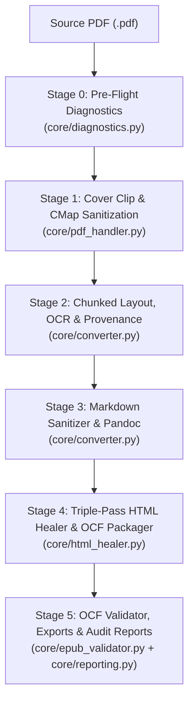

# Lume Processing Pipeline

This document traces a PDF document through all six stages of the Lume restoration pipeline, detailing the inputs, transformations, and outputs of each stage.

---

## End-to-End Data Flow

---

## Stage 0 — Two-Stage Pre-Flight Diagnostics (`core/diagnostics.py`)

- **Input**: Path to the source PDF file.
- **Transformations (Strictly Read-Only)**:
  1. **`quick_diagnostics()`**: Reads PDF metadata, page count, first-page dimensions (`wide_first_page_candidate` when `width > height * 1.05`), and classifies up to 12 evenly spaced sample pages in `< 100ms`. Sets `cmap_scan_completed = False` and `is_complete = False`.
  2. **`full_diagnostics()`**: Inspects every page using `page.get_text("blocks")`, `page.get_images(full=False)`, and `page.get_image_info()`, classifying each page into one of four states:
     - `extractable_text`: `>= 20` characters of selectable text and low image coverage.
     - `image_only`: `< 40` characters of text with embedded scan/image coverage.
     - `mixed`: `>= 40` characters of text combined with significant image area (`>= 15%` of page area, or `>= 5%` with embedded image objects) — typical of hybrid pages with figures or OCR text overlays.
     - `empty_or_unknown`: Blank separator pages or insufficient content.
  3. **Read-Only CMap Scan (`detect_cmap_issues_readonly`)**: Scans PDF `xref` streams for malformed `ToUnicode` mappings (`<23AF F8E7>` / `<F8E7>`) without mutating the file.
  4. **Unified OCR Strategy (`determine_ocr_strategy`)**: Recommends `"disable_ocr"` only when `>= 85%` of non-empty pages are pure `extractable_text` **and** `(image_only + mixed) <= 15%`; otherwise recommends `"full_ocr"`.
- **Output**: `DocumentDiagnostics` dataclass instance.

---

## Stage 1 — Cover Clipping & CMap Sanitization (`core/pdf_handler.py`)

- **Input**: Source PDF, target `cover.jpg` path, target `content.pdf` path, and `start_page`.
- **Transformations**:
  1. **Rotation-Safe Cover Extraction**: Renders the cover page at 4× resolution using `page.get_pixmap(matrix=fitz.Matrix(4, 4), clip=clip_rect)`. If `width > height * 1.05` (two-page spread cover), `clip_rect` crops the right-hand front cover (`x0 + width * 0.52` to `x1`) directly in visual coordinates, avoiding `set_cropbox()` errors on rotated pages (`90°`/`270°`).
  2. **ToUnicode CMap Repair (`_sanitize_pdf_cmaps`)**: Rewrites corrupted `begincmap`/`beginbfchar` streams in `content.pdf` that map Symbol font em-dashes to `<23af f8e7>` or `<f8e7>`, replacing them with standard Unicode `<2014>` (`—`).
- **Output**: `cover.jpg`, sanitized `content.pdf`, and `extraction_stats` (`wide_cover_cropped`, `cmap_issues_repaired`).

---

## Stage 2 — Chunked Layout, OCR & Block Provenance (`core/converter.py`)

- **Input**: `content.pdf` and the `disable_ocr` flag derived from `diagnostics.recommended_ocr_mode`.
- **Transformations**:
  1. **Compute Device Detection (`_detect_compute_device`)**: Probes the target Python environment for `cuda`, `mps`, or `cpu` (respecting `LUME_DEVICE` if set) and configures native PyTorch inference backends.
  2. **50-Page Batch Execution (`_CHUNKED_MARKER_SCRIPT`)**: Loads the Marker/Surya models once and processes `content.pdf` in 50-page windows, freeing intermediate tensors between chunks.
  3. **Single-Pass Provenance Extraction**: Invokes `JSONRenderer` on the in-memory `Document` object for each chunk to record leaf block IDs (`/page/N/BlockType/M`), 1-based page numbers, and normalized text snippets into `provenance_blocks.json`.
- **Output**: Raw `content.md`, extracted figures, and `provenance_blocks.json`.

---

## Stage 3 — Markdown Sanitizer & Pandoc Compilation (`core/converter.py`)

- **Input**: Raw `content.md` and `content.pdf`.
- **Transformations (`_sanitize_markdown`)**:
  1. Strips invalid inline `id`/`name` attributes and repairs OCR-corrupted `&lt;sup>N` tags.
  2. Normalizes any remaining Private Use Area (`\u23af\uf8e7`) or isolated ` ! ` Symbol font artifacts into em-dashes (`—`).
  3. Converts standalone section numbers (`1.`, `2.`, …, `80.`) into centered `### N.` Markdown headings.
  4. Recovers missing sequential section headers (e.g., `53` printed without a period, or `67.` dropped at the bottom of a PDF page by cross-checking the last lines of each page in `content.pdf`).
  5. Escapes paragraph-initial numbers (`44. Text` → `44\. Text`) so Pandoc does not convert numbered synopsis paragraphs into auto-renumbered `<ol>` lists.
  6. Compiles `content.md` into `temp.epub` via Pandoc with `--epub-cover-image`, `title`, `author`, and `lang=pt-BR`.
- **Output**: Base `temp.epub`.

---

## Stage 4 — Triple-Pass HTML Healer & OCF Packaging (`core/html_healer.py`)

- **Input**: `temp.epub` and `ProvenanceResolver`.
- **Transformations (`process_epub_html`)**:
  - **Pre-Pass (`heal_html`)**: Injects Kindle-safe CSS, unwraps false `` tags generated by OCR on ordinary letters (`é`, `o`), decomposes standalone leaked page-number paragraphs (`
329
`), normalizes em-dashes, and rejoins words hyphenated across line breaks (`sci- entific` → `scientific`) when the second fragment starts with a lowercase letter.
  - **Pass 1 (Global Footnote Memory & Paragraph Stitching)**:
    - `_extract_footnotes_from_soup()` extracts footnotes across 4 layout patterns (paragraphs starting with `N`, multi-note paragraphs, multi-paragraph footnote continuations, and classic `[N]`/`(N)` notes) into `g_notes`.
    - `_stitch_broken_paragraphs()` strips trailing leaked page numbers at the end of incomplete paragraphs and stitches sentences split across page breaks or removed footnote blocks, recording provenance-backed `TransformationSample` entries.
  - **Pass 2 (TOC Reconstruction & Context-Aware Link Hunting)**:
    - Detects Table of Contents `<table>` structures (`is_toc_table`) and converts them into float-based `
` blocks (`transform_toc_kindle_safe`) that do not clip on narrow Kindle screens.
    - Heals OCR character confusions on footnote markers (`1l` → `11`, `1O` → `10` via `heal_ocr_errors` when the target note exists in `g_notes`) and links footnote markers attached to words, closing quotes (`»`, `”`), ellipses (`…`), or inline tags (`<em>word</em>90,`).
  - **Pass 3 (Bidirectional Reinjection & OCF Packaging)**:
    - Appends `<section epub:type="footnotes">` at the end of each chapter containing referenced notes, generating `<a href="#ref-N-M">↩</a>` backlinks (`↩a`, `↩b` when cited multiple times).
    - Repackages the archive via `_package_epub()` with an uncompressed (`ZIP_STORED`) `mimetype` as the first ZIP entry.
- **Output**: Healed OCF-compliant `.epub` and populated `HealingStats`.

---

## Stage 5 — Validation Gate, Multi-Format Export & Reporting (`core/epub_validator.py`, `core/reporting.py`)

- **Input**: Healed `.epub`, `HealingStats`, `DocumentDiagnostics`, and requested output formats.
- **Transformations**:
  1. **Structural Validation (`validate_epub_structure`)**: Verifies OCF `mimetype` placement and compression (`PKG-006`/`PKG-007`), `META-INF/container.xml`, OPF manifest file existence (`RSC-001`) and spine `idref` integrity (`OPF-049`), XML well-formedness (`RSC-005`), and every internal `href`/`src` target and `#fragment` ID across the archive (`RSC-006`/`RSC-007`).
  2. **Strict Validation Gate**: When `strict_validation=True` and `not validation_summary.is_valid`, Lume blocks downstream Calibre conversions (`AZW3`/`PDF`), writes the diagnostic reports for inspection, and raises a `RuntimeError`.
  3. **Audit & Visual Comparison Reports**: Writes `restoration_report.json` (`v1.1.0`) and renders `comparison_report.html` alongside page thumbnails in `comparison_assets/`.
- **Output**: Final `.epub` (and optional `.azw3` / `.pdf`), `restoration_report.json`, and `comparison_report.html`.
